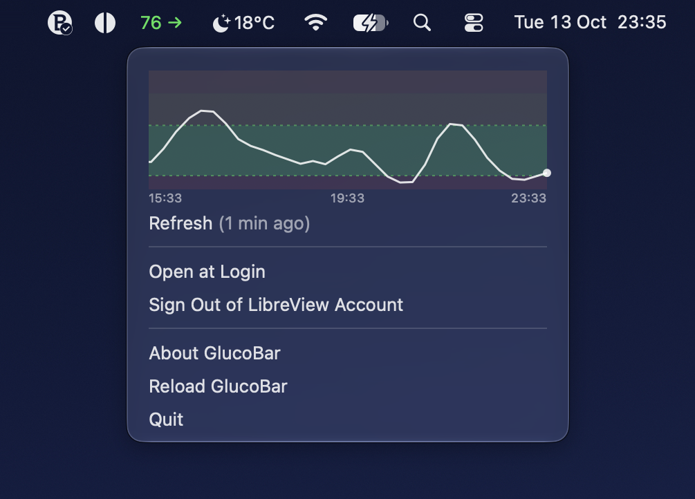

<p align="center">
  
</p>

<h1 align="center">Gluco</h1>

Gluco puts your latest glucose reading and trend in the macOS menu bar, so
you can stay on top of your diabetes **without breaking your focus**.

<p align="center">
  
</p>

Checking your phone pulls you out of whatever you're doing: unlock, open the
app, wait, and then the notifications get you. When you're deep in work, in
the zone, or just distracted, it's easy to put that check off and not notice
a high or a low until it's already affecting you. Gluco keeps the number
in the corner of your screen. A quick glance at `124 ↗` tells you whether
you're in range, rising, or dropping, and you're back to work in a second.

It doesn't replace the official Libre app. It's a convenience viewer for the
same LibreView data, and you still need the phone app for alarms and for
uploading readings.

- `daemon/` polls LibreView and serves local HTTP on `127.0.0.1:8765`.
- `macos_frontend/` is a menubar UI (`rumps` + AppKit) that reads from the daemon.
- LibreView credentials are stored in the macOS Keychain only (not in `.env`).

For internals and future direction, see `ENGINEERING.md`.  
For releases, see `RELEASING.md`.

## Important: your phone must stay connected

Gluco does **not** talk to your sensor. It only shows what your phone has
already uploaded to LibreView:

```
Libre sensor ──Bluetooth──▶ Libre app on your phone ──internet──▶ LibreView ──▶ Gluco
```

If any link in that chain breaks, Gluco stops getting new readings. For
Gluco to stay current, **all of the following must be true, all the time**:

- The official Libre app (FreeStyle LibreLink / FreeStyle Libre 3) is
**running on your phone** — open or in the background. Do not force-quit it
(on iPhone, don't swipe it away in the app switcher).
- **Bluetooth is on** and the phone is **within Bluetooth range of the
sensor** (keep it with you, not in another room).
- The phone has a working **internet connection** (Wi-Fi or mobile data) so
the app can upload to LibreView.
- The phone is not blocking the app in the background — for example, Low
Power Mode / battery saver, background app refresh turned off, or
aggressive battery optimisation on Android can delay or stop uploads.
- The sensor is active (not warming up, expired, or failed) and you have
accepted any pending Terms/Privacy prompts in the Libre app.

When readings stop arriving, Gluco keeps showing the last value with an
asterisk (for example `124 ↗*`) once it is more than 6 minutes old. **Treat a
starred value as out of date** — check your phone or meter instead.

## Known limitations

- **Unofficial API that may stop working.** Gluco reads data through the
unofficial LibreLinkUp API (via
[`pylibrelinkup`](https://pypi.org/project/pylibrelinkup/)). Abbott has
released LibreLinkUp API v5, which encrypts glucose data so third-party
tools can't read it. Gluco only works while Abbott keeps the older API
running. When Abbott turns it off, Gluco (like other community LibreView
tools) will stop getting readings, possibly with no notice. There is no
plan to work around the v5 encryption.
- **Readings are delayed.** Values go sensor → phone → LibreView → Gluco,
and Gluco checks LibreView every 60 seconds. Expect the menu bar to run
a minute or more behind your phone, and longer if the phone uploads late
(see [above](#important-your-phone-must-stay-connected)).
- **No alarms.** Gluco does not alert, notify, or make sounds for highs or
lows. Keep using the official Libre app's alarms.
- **Signs in with your LibreView account.** Use the same email and password
as LibreView.com. Gluco shows the readings LibreView makes available to
that account through LibreLinkUp. If LibreView lists nobody for the account,
Gluco shows `⚠ Sign In`; setting up sharing in the Libre app
(Connected Apps → LibreLinkUp) usually fixes it.
- **One patient only.** If several people share with the account, Gluco
shows the first one LibreView returns. There's no picker yet.
- **Short history.** The graph covers the last 12 hours, which is all the
history LibreView returns through this API. There are no long-term reports.
- **macOS only**, and release builds aren't notarized (see
[First launch](#first-launch-apple-could-not-verify-warning)).
- **Not a medical device** (see below).


## Disclaimer

Gluco is **not a medical device** and must not be used for diagnosis,
treatment, dosing, emergency decisions, or any other medical decision.
Glucose values may be delayed, missing, or wrong. Always confirm with your
official LibreView/LibreLink app, a meter, or a qualified professional.

This is an **independent open-source** project. It is not affiliated with,  
endorsed by, or supported by Abbott. Abbott trademarks (for example  
FreeStyle Libre, LibreLink, LibreView) are property of Abbott Laboratories.

## License, notices, and third-party credit

- **License:** [Apache-2.0](LICENSE) — see `LICENSE` for the full text.
- **NOTICE:** Project and third-party attribution summary (`NOTICE`).
- **Open source and assets:** [ATTRIBUTIONS.md](ATTRIBUTIONS.md) — runtime
dependencies, build tools, the app icon, and how to verify
transitive licenses.
- **Copyright:** A copyright line in `NOTICE` and in the app bundle
(`NSHumanReadableCopyright`) is the usual way to record authorship under
Apache-2.0. It is not a substitute for professional legal advice about
liability (see the disclaimer above).


## Requirements

- macOS 11+
- Python 3.11+
- Active Libre sensor + LibreLink phone app uploading to LibreView — the
phone app must stay running, with Bluetooth and internet on (see
[Important: your phone must stay connected](#important-your-phone-must-stay-connected))
- LibreView account credentials


## Install with Homebrew

```bash
brew tap edusantosdev/gluco https://github.com/edusantosdev/gluco-python
brew trust --cask edusantosdev/gluco/gluco
brew install --cask edusantosdev/gluco/gluco
```

Recent Homebrew versions refuse to load casks from third-party taps until you
trust them; `brew trust` does that for this one cask only. If your Homebrew
says `Unknown command: trust`, it's older and you can skip that line.

Upgrade later with `brew upgrade --cask gluco`. The first-launch
warning below still applies to Homebrew installs.

### Upgrading from GlucoBar

Gluco used to be called GlucoBar, and its cask was `gluco-bar`. Homebrew
trusts casks by name, so trust the new name once before updating:

```bash
brew trust --cask edusantosdev/glucobar/gluco
brew update
brew upgrade --cask gluco
```

Until you do, `brew update` reports that it refuses to load `gluco` from an
untrusted tap, and Gluco stops upgrading. Your sign-in and settings carry
over, and if Open at Login was on, Gluco moves it to the new app the first
time it opens.

## Install from a GitHub release

1. Download `Gluco-vX.Y.Z-macos.zip` from the
  [Releases](https://github.com/edusantosdev/gluco-python/releases) page.
   Optionally check it against the `.sha256` file:
   `shasum -a 256 -c Gluco-vX.Y.Z-macos.zip.sha256`
2. Unzip it and move `Gluco.app` to `/Applications`.
3. Open it (see below for the first-launch warning).


### First launch: "Apple could not verify…" warning

Release builds are **not signed with an Apple Developer ID and not notarized
by Apple**. Notarization is Apple's automated malware scan for apps
distributed outside the App Store, and it requires a paid Apple Developer
account. It is not a code review. Without it, Gatekeeper blocks the first
launch with *"Gluco.app" Not Opened: Apple could not verify
"Gluco.app" is free of malware…* and only **Move to Trash** / **Done**
buttons. Click **Done**, not Move to Trash. This does not mean the app was found to be
harmful; macOS just has no Apple-issued signature to check.

To open it anyway (needed only once per downloaded version):

- **macOS 15 Sequoia and later:** try to open the app, dismiss the warning,
then go to **System Settings → Privacy & Security**, scroll down to the
message about Gluco, click **Open Anyway**, and confirm.
- **macOS 14 and earlier:** right-click (or Control-click) `Gluco.app` in
Finder, choose **Open**, then click **Open** in the dialog.
- **Terminal alternative (any version):** remove the download quarantine flag:
  ```bash
  xattr -dr com.apple.quarantine /Applications/Gluco.app
  ```

Only do this for a zip you downloaded from this repository's Releases page.
If you'd rather not trust a prebuilt binary, build the app from source
(below). It's the same code, built on your own machine.

## Build and run (`.app`)

```bash
python3.11 -m venv .venv
.venv/bin/python -m pip install -e '.[dev,build]'
scripts/build_portable_app.sh
open dist/Gluco.app
```

After building, you can launch `dist/Gluco.app` directly from Finder
(or move it to `/Applications`).

Optional `.env` for non-credential settings:

```bash
cp .env.example .env
open -e .env
```

First launch prompts for LibreView credentials and stores them in Keychain.
You can also set credentials from terminal:

```bash
.venv/bin/python scripts/set_credentials.py
```

Verify account + region quickly:

```bash
.venv/bin/python scripts/phase0_probe.py
```


## Runtime

The menubar supervises the daemon as a child process. If a daemon is
already running (e.g. you started one in a terminal), the menubar
attaches to it instead of spawning its own.

## Menubar Status

- Fresh reading: `124 ↗`
- Stale with last value: `124 ↗*`
- Starting/warming/rate-limited: `Connecting…`
- No network/daemon unreachable: `⚠ Offline`
- Auth/ToS issue: `⚠ Sign In`
- Unexpected daemon failure: `⚠ Error`

Menu actions:

- `Refresh` — force daemon re-auth + immediate UI update
- `Open at Login` — toggle macOS login item registration for next login
- `Sign In to LibreView Account…` / `Sign Out of LibreView Account` — manage Keychain credentials
- `About Gluco` — version, author, repository link, license, and disclaimer
- `Restart Gluco` — quit and reopen the app and its daemon
- `Quit Gluco`


## Configuration

Credentials are Keychain-only. Only the menubar app (`Gluco`) reads
Keychain; it forwards credentials to the daemon subprocess
(`GlucoDaemon`) via env, so you only see a single "Gluco wants to
access the glucobar Keychain item" dialog — click **Always Allow** and
you're set. The bundled `.app` is ad-hoc code-signed by
`scripts/build_portable_app.sh` so the grant persists across launches
of the same build.

Common `.env` variables:

- `LIBREVIEW_REGION` (cluster, default inferred from locale)
- `DAEMON_URL` (default `http://127.0.0.1:8765`)
- `DAEMON_STATE_DIR` (default `~/.glucobar`)
- `LOG_LEVEL` (default `INFO`)
- `ERROR_BACKOFF_BASE_SECONDS` / `ERROR_BACKOFF_CAP_SECONDS`
- `RATELIMIT_BACKOFF_BASE_SECONDS` / `RATELIMIT_BACKOFF_CAP_SECONDS`

Fixed runtime defaults:

- daemon poll interval: 60s
- frontend poll interval: 30s
- stale cutoff: 360s
- color thresholds: `<70`, `70-180`, `180-250`, `>250` mg/dL


## Packaging for releases

Create release zip + SHA:

```bash
scripts/package_release_artifact.sh --repo <owner>/<repo>
```

For the full release flow (tag, publish, update tap), see `RELEASING.md`.

## Troubleshooting

- Value has a `*` / readings stopped updating: the problem is almost always on
the phone side. Open the Libre app on your phone and check that it shows a
current reading, Bluetooth is on, the phone is near the sensor and online, and
the app wasn't force-quit. Once the phone uploads again, Gluco catches up
on its next poll.
- Account/region issues: run `.venv/bin/python scripts/phase0_probe.py`.
- Missing credentials: open the app once or run `.venv/bin/python scripts/set_credentials.py`.
- Rebuilt venv / upgraded Python: rerun `scripts/build_portable_app.sh`.
- `Package 'gluco' requires a different Python` (for example 3.9.x): recreate
`.venv` with Python 3.11+.
- Editable install fails because of old packaging tooling: run
`.venv/bin/python -m pip install --upgrade pip setuptools wheel`.
- zsh reports `no matches found` for extras install: run
`.venv/bin/python -m pip install -e '.[dev,build]'` (quoted). If pasted
comment lines still trigger globbing, avoid comments in pasted blocks or enable
`setopt interactivecomments` in your shell.
- "Another glucose daemon is already running": stop any manual `python -m daemon`, then relaunch.
- Check daemon logs: tail `~/.glucobar/daemon.log`.


## Development

```bash
.venv/bin/python -m pytest tests/
.venv/bin/python -m ruff check .
```

